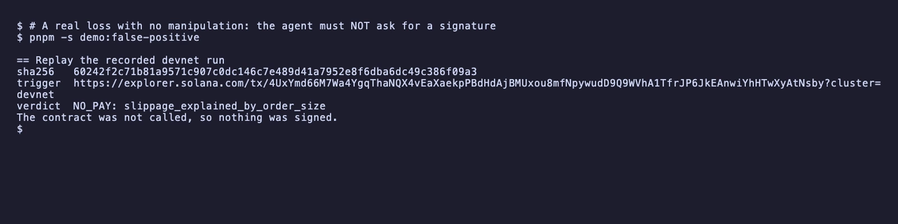
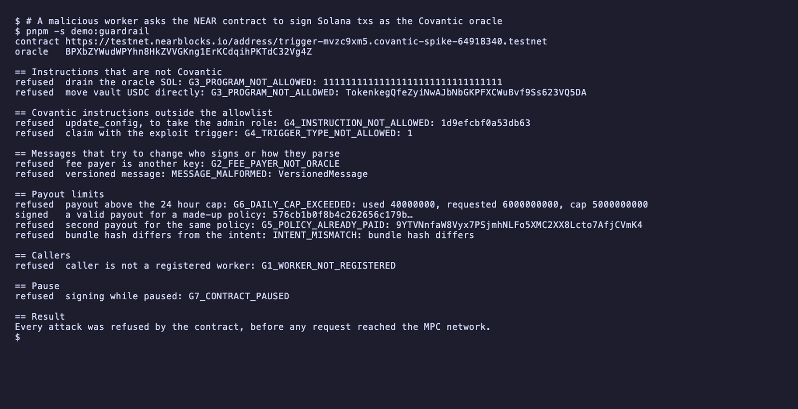

# Covantic Keyless Oracle (NEAR HACKATHON)

Built at NEAR HACKATHON, 2026-11-01 to 2026-11-14. Tracks: AI Security & Defense, Agent Economy,
Unstoppable DeFi.

## The problem

[Covantic](https://github.com/mihailShumilov/covantic) is parametric insurance for AI agents on Solana
devnet. When a covered loss happens, the program pays the policy holder in USDC. Every payout
instruction is bounded by state the program reads itself, but one thing was still centralised: **who
may call those instructions**. Each claim and payout instruction requires
`oracle: Signer` with `config.oracle_authority == oracle.key()`, and that authority was one keypair on
one server. Lose it and claims stop. Steal it and the attacker can do anything the program still
allows. A dishonest operator can refuse to pay.

## What this builds

The oracle keypair is replaced by a Solana address that **no one holds a private key for**:

- The address is an Ed25519 key derived by **NEAR Chain Signatures** (MPC contract
  `v1.signer-prod.testnet`, domain 1) from the id of a NEAR agent contract and the path
  `covantic-oracle-v1`. The key exists only as threshold shares in the NEAR MPC network.
- Only the NEAR agent contract (`contracts/trigger`, Rust, near-sdk) can ask MPC to sign for it.
- The contract only signs for a **registered worker** (Shade Agent pattern: TEE attestation of an
  approved code hash, or a whitelist in local mode), and only after it has **parsed the raw Solana
  message** and checked it against on-chain guardrails.
- The worker (`agent/`, TypeScript) watches Covantic policies, evaluates the oracle-manipulation
  trigger, builds the Solana transaction, gets it signed through the contract and broadcasts it.

The Solana program does not change. Switching to this oracle is one `update_config` call by the
Covantic admin.

```
 Solana devnet                              NEAR testnet
 Covantic program (unchanged)               trigger contract
   oracle_authority = ADDR   <--- signed tx    guardrails G1..G7, payout log
            ^                                  calls MPC sign(Eddsa) ---> v1.signer-prod.testnet
            |                                       ^
 Worker agent: watch -> predicate -> build tx ------+ request_signature(message, intent)
 ADDR = Ed25519 key derived from (contract id, "covantic-oracle-v1", domain 1)
```

### Guardrails enforced by the NEAR contract before MPC is called

| Id | Rule | Typed error |
| --- | --- | --- |
| G1 | Caller is a registered worker | `G1_WORKER_NOT_REGISTERED` |
| G2 | Fee payer and oracle signer are the derived address; legacy messages only | `G2_FEE_PAYER_NOT_ORACLE`, `MESSAGE_MALFORMED` |
| G3 | Every instruction targets the Covantic program or ComputeBudget. No System or SPL Token instruction, so the oracle can never move its own funds | `G3_PROGRAM_NOT_ALLOWED` |
| G4 | Covantic instruction is `oracle_submit_claim`, `verify_and_payout_v2` or `upsert_attestation`; the trigger type is allowed | `G4_INSTRUCTION_NOT_ALLOWED`, `G4_TRIGGER_TYPE_NOT_ALLOWED` |
| G5 | One payout per policy | `G5_POLICY_ALREADY_PAID` |
| G6 | Rolling 24 h cap on payout total and on operation count | `G6_DAILY_CAP_EXCEEDED` |
| G7 | Contract not paused (owner only) | `G7_CONTRACT_PAUSED` |
| - | The intent (policy, trigger, evidence hash) matches the message | `INTENT_MISMATCH` |

Every signed request is recorded in the contract (`get_intents`, `get_payout`).

### The trigger predicate

`agent/src/predicate` is deterministic: the same evidence gives the same verdict. It compares the
execution price of the trigger transaction with a reference price from independent sources, requires a
deviation the program can prove (at least 50 bps, Pyth price within 5 s of the trigger), checks the
policy is active and past its waiting window, and rules out losses explained by order size. A
`NO_PAY` verdict is logged and the contract is never called. The evidence bundle is canonical JSON with
a sha256, the same field as the program's `ClaimEvidence.evidence_hash`.

## Try it

Requires Node 22+, pnpm 9+, Rust (the toolchain is pinned in `contracts/trigger/rust-toolchain.toml`).
From the repository root:

```sh
git checkout near-hackathon
pnpm install
cd packages/near-oracle
```

### 1. Tests, no keys needed

```sh
pnpm test
```

You see the contract's Rust tests for every guardrail, then 15 Vitest tests: the predicate, a check that
the agent loads the baseline adjudicator without any database or API, and byte-for-byte parity between
the agent's transaction and the Anchor client's.

### 2. False positive, no keys needed

```sh
pnpm demo:false-positive
```

Replays a swap recorded on devnet on 2026-11-14
([transaction](https://explorer.solana.com/tx/4UxYmd66M7Wa4YgqThaNQX4vEaXaekpPBdHdAjBMUxou8mfNpywudD9Q9WVhA1TfrJP6JkEAnwiYhHTwXyAtNsby?cluster=devnet)).
The agent's order took two thirds of the venue's reserve, so it lost money without any manipulation.
You see `verdict NO_PAY: slippage_explained_by_order_size` and `The contract was not called, so
nothing was signed.`



The recording is checked against its sha256 first. `--live` stages a fresh swap
and needs a funded devnet funder (`pnpm funder` prints its address).

### 3. Guardrails against a live contract on NEAR testnet

Deploy your own copy (a testnet account from the faucet covers it):

```sh
pnpm near:account   # creates a testnet account through the faucet helper, key stored in .env
pnpm near:deploy    # deploys the contract, registers a worker with a function-call key only
pnpm demo:guardrail
```

You see each attack refused with its typed error, for example:

```
refused  drain the oracle SOL: G3_PROGRAM_NOT_ALLOWED: 11111111111111111111111111111111
refused  update_config, to take the admin role: G4_INSTRUCTION_NOT_ALLOWED: 1d9efcbf0a53db63
refused  fee payer is another key: G2_FEE_PAYER_NOT_ORACLE
refused  payout above the 24 hour cap: G6_DAILY_CAP_EXCEEDED: used 0, requested 6000000000, cap 5000000000
signed   a valid payout for a made-up policy: cfe95da8...
refused  second payout for the same policy: G5_POLICY_ALREADY_PAID: ...
refused  caller is not a registered worker: G1_WORKER_NOT_REGISTERED
refused  signing while paused: G7_CONTRACT_PAUSED
```



The one valid request really is signed by the MPC network; it uses a made-up blockhash and policy, so
it can never land on Solana.

Our deployment, run on 2026-11-14:
[`trigger-mvzc9xm5.covantic-spike-64918340.testnet`](https://testnet.nearblocks.io/address/trigger-mvzc9xm5.covantic-spike-64918340.testnet),
derived Solana oracle address `BPXbZYWudWPYhn8HkZVVGKng1ErKCdqihPKTdC32Vg4Z`.

### 4. Chain Signatures landing on Solana

`pnpm spike` derives an Ed25519 address from a NEAR account, has MPC sign Solana devnet transactions
and lands them. Recorded runs, all confirmed with `err: null`, signing in 4.8 to 5.7 s (about 22 of
150 blockhash-valid blocks):
[4tALZvGM](https://explorer.solana.com/tx/4tALZvGMVHkv5MozKE8tVBwki4RFpxEZv9sUeaohoub2ovtMzYP1KbjLwfzCcy7k1SRSxiUfHXpkYLgwQgwFoyhE?cluster=devnet),
[3Njj4raH](https://explorer.solana.com/tx/3Njj4raHziGzQ8NG8KPMGoa8panpbVgbRkysqWVxLR1yEtqojhkzFw2GuKj6iyMGmfy4mKcA5a5QXT2VJtdjexhH?cluster=devnet),
[2HnEnz1S](https://explorer.solana.com/tx/2HnEnz1ScMtnVapHRNzX3UoAZMgQhQ6L4yyAkAbWTxqHzWAYbpx1NvdaVuPJ9AzpfNEqFHQRuvAwSh1VauCkPfrM?cluster=devnet).
Measurements and verified facts are in [`NOTES.md`](NOTES.md).

## Status, stated plainly

| Part | State |
| --- | --- |
| Trigger contract with guardrails, deployed to NEAR testnet | Done, demo above |
| Chain Signatures signing Solana transactions that land on devnet | Done, transactions above |
| Agent: watcher, predicate, transaction builder, signing, broadcast, evidence | Done, tested |
| False-positive twin | Done, recorded on devnet |
| `pnpm demo:payout`: full payout on devnet signed by the derived address | Written, not run: needs a Pyth Hermes API key, which the payout proof requires |
| Covantic devnet `oracle_authority` switched to the derived address | Not done; `pnpm admin:set-oracle` prints the command |
| Worker in a TEE on Phala | Not done. The contract and agent run in **local mode** (`requires_tee = false`, worker admitted by whitelist). `@neardefi/shade-agent-js` 2.2.0 fails to load its TEE path under Node here (`@noble/hashes` 2.x has no `./sha3` export) |

## Trust model

- No single private key can sign as the Covantic oracle.
- The contract only requests signatures for registered workers, and the guardrails cap what any worker
  can get signed, even a compromised one.
- The Solana program still bounds every payout from state it reads itself.
- Remaining trust: the MPC network's honesty threshold, the contract owner (pause, limits, worker
  approval), the correctness of the predicate code, and, in local mode, the whitelisted worker. With a
  TEE, that last item becomes TEE hardware integrity.

## Out of scope

Mainnet. Exploit, governance and agent-error triggers (same contract, more predicates). Moving the
vault, policies or staking to NEAR. Any change to the Covantic Solana program. NEAR Intents.

## What is new and what is baseline

Covantic itself existed before the hackathon and is not what is judged (Q-002). Everything NEAR is new
and lives in this package on the `near-hackathon` branch:

- Baseline: tag [`pre-hackathon`](https://github.com/mihailShumilov/covantic/tree/pre-hackathon)
  (`fc4e4ad`), the Covantic protocol, its Solana program and the `@covantic/shared` adjudicator, which
  the predicate reuses.
- Hackathon work: [`pre-hackathon...near-hackathon`](https://github.com/mihailShumilov/covantic/compare/pre-hackathon...near-hackathon).
- `idl/covantic.json` is the IDL of the already-deployed Covantic program, included as an artifact.

Libraries: near-sdk, `shade-attestation`, near-api-js 7.4.0, `@neardefi/shade-agent-js` 2.2.0,
`@solana/web3.js`, `@solana/spl-token`, `@coral-xyz/anchor`, `@pythnetwork/pyth-solana-receiver`,
Vitest.

## Layout

```
contracts/trigger/   NEAR contract: guardrails, message parser, payout log, tests
agent/src/           worker: watcher, predicate, Solana tx builder, NEAR client, pipeline
scripts/             near-deploy, demo-guardrail, demo-false-positive, demo-payout, derive-address, admin-set-oracle
spike/               day-1 Chain Signatures spike
fixtures/            recorded devnet evidence for the false-positive replay
```

License: MIT, see the repository root.
